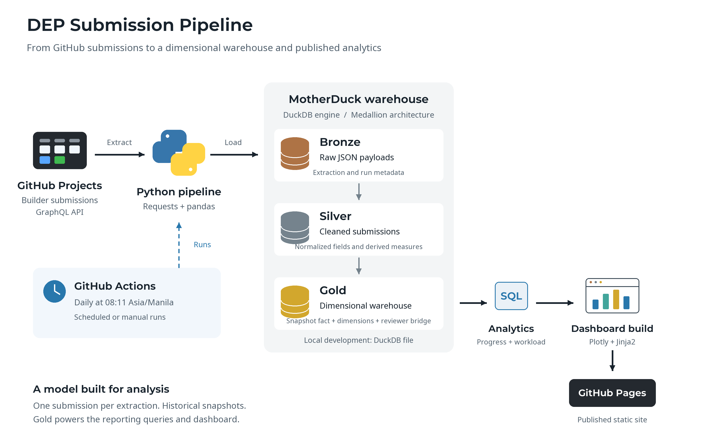
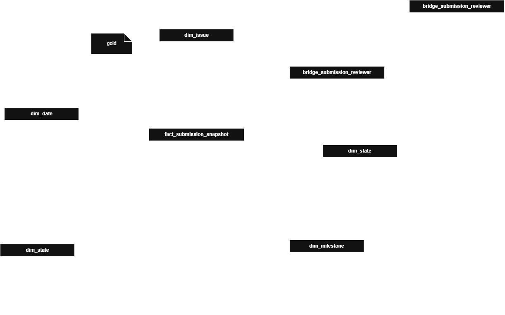

<p align="center">
  
</p>

# DEP Open Track Submission Pipeline

A data pipeline and dimensional warehouse for tracking builder submissions in the Data Engineering Pilipinas (DEP) Open Track program.

I built this project to turn GitHub Projects data into a useful view of builder progress and reviewer workload. It brings together API ingestion, layered transformations, Kimball-style dimensional modeling, SQL analytics, and a static dashboard.

## Background and Data Engineering Pilipinas

This project connects my data engineering work with the Data Engineering Pilipinas community and its Open Track program. Builders submit milestone work through GitHub, creating a practical challenge: understanding who is progressing, which submissions need attention, and where review work is accumulating.

The pipeline captures submissions over time and organizes them into a warehouse designed for reporting. Its goal is to help program tracking move from inspecting individual issues to answering questions across builders, milestones, and reviewers.

## Dashboard and Business Questions

The dashboard provides overview, builder, and reviewer pages, built from SQL queries against Gold. It answers:

- How are submissions distributed across milestones and statuses?
- How many observed builders are on track or delayed?
- How does milestone completion change over time?
- Which builders need attention, and who should act next?
- How much unresolved work is assigned to each reviewer?

To explore the dashboard without GitHub or MotherDuck credentials, use the [fixture preview instructions](#preview-the-dashboard-without-credentials).

## End-to-End Architecture



| Component | Technology and purpose |
| --- | --- |
| Extraction and transformation | Python, Requests, and pandas |
| Warehouse | DuckDB locally; MotherDuck for the production pipeline |
| Orchestration | GitHub Actions, with scheduled and manual execution |
| Analytics | SQL queries over the Gold schema |
| Presentation | Plotly charts and Jinja2 templates rendered as a static site |
| Publishing | GitHub Pages deployment workflow |
| Dependency management | uv and a committed lockfile |

The pipeline workflow is configured to run daily at **08:11 Asia/Manila (00:11 UTC)**. The dashboard workflow builds from Gold on pushes to `main`, successful pipeline workflow completion, or manual dispatch.

## Gold Layer: Dimensional Warehouse Design

Gold is the analytical core of this project. I organized the model around the business process of tracking milestone submissions, defined the grain, and then selected the dimensions and measures needed to analyze it.



The image provides a model overview. Some labels differ from the current implementation; the table names and relationships below follow the [warehouse DDL](src/pipeline/etl/load.py).

### Business Process and Grain

> One row in `gold.fact_submission_snapshot` represents the state of one submission as observed during one pipeline extraction.

The table follows a periodic snapshot approach: repeated extractions preserve observations of submissions across time. Its uniqueness constraint is `UNIQUE(issue_key, extracted_at)`, and `run_id` traces each observation back to its pipeline run.

This grain supports both the latest view of the program and comparisons across extractions. A submission observed on several dates contributes several historical snapshots, so counting all fact rows would not produce a current submission count.

### Facts, Dimensions, and Relationships

| Table | Analytical purpose |
| --- | --- |
| `gold.fact_submission_snapshot` | Stores dimension references, source timestamps, assignment flag, days since update, and submission age for each observation |
| `gold.dim_issue` | Identifies the submission and holds its title, URL, and author |
| `gold.dim_state` | Describes the GitHub issue state |
| `gold.dim_status` | Describes the submission's review status; a snapshot may have no status |
| `gold.dim_milestone` | Holds milestone numbers and configured deadlines, including milestones with no submissions |
| `gold.dim_date` | Provides calendar attributes for grouping by creation, update, and extraction dates |
| `gold.dim_reviewer` | Identifies reviewers independently of submissions |
| `gold.bridge_submission_reviewer` | Associates snapshots with reviewers through a composite primary key |

### Modeling Decisions

- **Persistent surrogate keys:** the loader resolves natural keys to database-managed dimension keys, keeping references consistent across runs.
- **Role-playing date dimension:** creation, update, and extraction dates reference the same calendar dimension through three separate keys. Original timestamps are retained for finer analysis.
- **Reviewer bridge:** a submission can have multiple reviewers. A bridge preserves those assignments while keeping one fact row per submission observation.
- **Snapshot measures:** submission age and days since update describe the observation at extraction time. They should not be summed across snapshots to represent elapsed time.
- **Historical workflow state:** state, status, milestone, and reviewer relationships are recorded for each snapshot, allowing progress to be compared across observations.

Issue attributes are updated in place when reloaded, following a Type 1 approach. The model preserves submission observations, but does not preserve every historical version of an issue's title or author.

## Bronze and Silver: Preparing Trustworthy Data

### Bronze: Preserve the Source

`bronze.raw_issue_extractions` stores the extracted JSON payload, extraction timestamp, run ID, and attempt number. Retaining the payload allows downstream transformations to be rerun without requesting the same observation from GitHub again.

`ops.pipeline_attempts` records attempt outcomes and failure information. Pending Silver processing selects the latest successful Bronze attempt for each run.

### Silver: Shape the Analytical Input

`silver.issue_submissions` turns nested API responses into tabular submissions. The transformation:

- Extracts reviewers, milestone labels, and project status fields.
- Applies milestone-title and author-exclusion rules for the program's reporting scope.
- Retains the newest-created submission per author and milestone within an extraction.
- Converts timestamps to Asia/Manila and derives assignment, submission-age, and days-since-update fields.

The Silver primary key is `(run_id, issue_id)`. These rules define which source issues reach the warehouse and therefore influence every dashboard metric.

## Pipeline Execution and Reliability

The production entry point runs extraction, Bronze persistence, Silver transformation and loading, and Gold transformation and loading.

- **Paginated extraction:** follows GitHub GraphQL cursors and rejects invalid pagination responses.
- **Bounded retries:** handles transient connection errors, rate limits, and selected server responses with capped delays.
- **Attempt tracking:** identifies runs and attempts, records failures by stage, and skips Bronze attempts that already have a final outcome.
- **Transactional loads:** Bronze payload and success metadata are committed together; Gold dimensions, facts, bridge rows, and load tracking are committed together.
- **Repeat-load protection:** `ops.gold_loads` tracks completed Gold runs so loading the same run again does not append another set of facts.
- **Recovery commands:** separate Silver and Gold commands process pending stored data after downstream failures.

The implementation lives in [`src/pipeline`](src/pipeline).

## Analytics Built on Gold

The [analytics queries](src/analytics/queries) translate the warehouse into dashboard datasets with explicit counting rules:

| Analysis | Current rule |
| --- | --- |
| Submission distribution | Counts submissions by milestone and non-null status at the latest extraction |
| Builder schedule | Compares each observed author's highest submitted milestone with the expected milestone; within one milestone is classified as on track |
| Progress over time | Averages each observed builder's distinct passed milestones divided by the number of milestones in the dimension, per extraction |
| Builder interventions | Selects one current submission per builder, prioritizing the highest milestone, and assigns a next actor and action |
| Reviewer workload | Counts distinct open, non-passed current builder submissions per reviewer, including an unassigned group |

Builder counts cover authors represented in the submissions, rather than the entire enrolled cohort. Schedule status measures submission progress; it does not mean every earlier milestone has passed review. A submission assigned to multiple reviewers counts toward each reviewer's workload, so reviewer totals are not additive across reviewers.

## Running the Project

### Install Dependencies

Use uv to install the locked dependencies. The repository's `.python-version` selects Python 3.13.

```sh
uv sync --locked
```

### Configure the Pipeline

Create a local `.env` file with the configuration needed for your chosen mode:

```dotenv
TOKEN=your_github_token
OWNER_NAME=your_project_owner
OWNER_TYPE=organization
PROJECT_NUMBER=1
MOTHERDUCK_TOKEN=your_motherduck_token
MOTHERDUCKDB_PATH=md:your_database
```

Use `organization` or `user` for `OWNER_TYPE`. The GitHub token needs access to the source project. `PROJECT_NUMBER` is its project number, and the MotherDuck path must begin with `md:`.

For GitHub Actions, configure secrets `DEP_GITHUB_TOKEN` and `MOTHERDUCK_TOKEN`, and repository variables `OWNER_NAME`, `OWNER_TYPE`, `PROJECT_NUMBER`, and `MOTHERDUCKDB_PATH`. The workflow maps `DEP_GITHUB_TOKEN` to the application's `TOKEN` variable.

### Run and Recover the Pipeline

```sh
# GitHub -> Bronze -> Silver -> Gold in MotherDuck
uv run dep-pipeline-prod

# GitHub -> Bronze -> Silver -> Gold in local DuckDB
uv run dep-pipeline-dev

# Process stored Bronze runs that are pending in Silver
uv run dep-pipeline-silver-manual

# Process stored Silver runs that are pending in Gold
uv run dep-pipeline-gold-manual
```

Local DuckDB defaults to `data/warehouse.duckdb`; override it with `DUCKDB_PATH`. The manual recovery commands use MotherDuck.

`uv run dep-pipeline-dev --local` loads a local payload into Bronze only. Supply an extraction payload containing a `pages` list at `data/rawpayload.json`, or set `SAMPLE_DATA_PATH`; local data files are excluded from version control.

### Preview the Dashboard Without Credentials

```sh
uv run dep-dashboard-build --source fixtures --output site
uv run python -m http.server 8000 --directory site
```

Open `http://localhost:8000`. This preview uses fixture data rather than actual program results.

To build from the MotherDuck Gold layer instead:

```sh
uv run dep-dashboard-build --source gold --output site
```

## Testing and Validation

The test suite covers extraction and retries, run metadata, Bronze lifecycle, Silver transformations, Gold modeling and loading, analytics queries, dataset validation, and dashboard generation.

```sh
uv run python -m unittest discover -s tests
```

Browser checks are opt-in. Install Chromium with `uv run playwright install chromium`, set `RUN_BROWSER_TESTS=1` in your shell, then run the suite to include them.

## Design Tradeoffs and Next Steps

- **Observation-based history:** snapshots capture extraction-time state. Changes between extractions are not available as individual events.
- **Program-specific rules:** milestone deadlines, author exclusions, and submission selection are encoded in Python. Moving them to maintained configuration would make the project easier to reuse.
- **Cohort coverage:** adding a builder roster would allow reporting on enrolled builders who have not submitted anything.
- **Activity interpretation:** GitHub's `updated_at` can reflect any issue update. A future inactivity metric needs more specific activity data to distinguish builder and reviewer actions.
- **Dimension history:** Type 2 dimensions could preserve changing descriptive attributes if historical reporting requires them.
